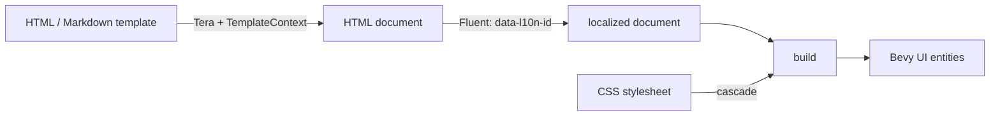

# bevy_markup


Write game UI the way you'd write a web page, and get native
[Bevy](https://bevyengine.org) UI out of it.

> **Early development.** bevy_markup is young and its API is unstable:
> expect breaking changes in most releases (0.3 → 0.4 → …) as features land
> and designs settle. Cargo won't move you to a new 0.x minor version on its
> own; read [CHANGELOG.md](CHANGELOG.md) before you do. Bug reports and
> feedback are very welcome.

bevy_markup is a Bevy 0.20 library. You describe a piece of UI as an HTML
template (or Markdown), style it with CSS, and translate it with
[Fluent](https://projectfluent.org); bevy_markup turns that into ordinary
Bevy UI entities (`Node`, `Text`, `TextSpan`, `ImageNode`). No browser, no
web view: the result is plain Bevy UI that lays out with Bevy's own flexbox
and renders like everything else in your game.

Text fields, links, forms, focus and gamepad navigation, tooltips, custom
elements, overlays — the interactive parts are built in and declared in the
template, so a settings screen or a shop menu is markup plus a few small
systems on your side.

```html
<!-- examples/assets/quickstart/hello.html -->
<h1 data-l10n-id="hello-title">Hello, HTML!</h1>
<p data-l10n-id="hello-greeting" data-l10n-args='{"name": "{{ player }}"}'>Welcome, {{ player }}.</p>
<div class="wallet">
  <p data-l10n-id="hello-coins" data-l10n-args='{"coins": {{ coins }}}'>You have {{ coins }} coins.</p>
  <div class="actions">
    <p id="add-coin" class="action" autofocus data-on-click="add-coin" data-l10n-id="hello-add-coin">+ Add a coin</p>
    <p id="language" class="action" data-on-click="switch-language" data-l10n-id="hello-language">Language</p>
  </div>
</div>
```

```css
/* examples/assets/quickstart/style.css */
html {
  color: #e6e6e6;
  font-family: serif;
  font-size: 24px;
  border-image: url("../ui/frame.png") 16 fill stretch; /* a 9-slice frame */
  border-width: 16px;
  padding: 20px 32px;
}
.action { color: #f0b429; }             /* plus a 9-slice background */
.action:focus-visible { outline: 3px solid #7fdbff; }
```

```ftl
# examples/assets/quickstart/locales/en-US/hello.ftl
hello-greeting = Welcome, <b>{ $name }</b>.
hello-coins =
    { $coins ->
        [0] You have <em>no</em> coins.
        [one] You have <em>one</em> coin.
       *[other] You have <em>{ $coins }</em> coins.
    }
```

```rust
use bevy::prelude::*;
use bevy_markup::prelude::*;

fn main() {
    App::new()
        .add_plugins((DefaultPlugins, BevyMarkupPlugin))
        .add_systems(Startup, setup)
        .run();
}

fn setup(mut commands: Commands, assets: Res<AssetServer>) {
    commands.spawn(Camera2d);
    commands.insert_resource(DefaultStylesheet::new(assets.load("quickstart/style.css")));
    commands.insert_resource(ActiveLocale::new(assets.load("quickstart/locales/en-US/main.ftl.ron")));
    commands.spawn((
        HtmlUi::new(assets.load("quickstart/hello.html")),
        TemplateContext::new().with("player", "Ada").with("coins", &0),
    ));
}
```

## How you work with it

**Interaction is declared in the template.** `data-on-click="buy"` sends a
`buy` message when the element is clicked — or activated with Enter / gamepad
A while focused. `data-on-auxclick` (middle/right), `-press`, `-release`,
`-enter` and `-leave` work the same way, and `data-with` carries JSON data
rendered with the template's context. Route the messages with
`app.on_html_click("buy", system)` (or drain them yourself); each one says
what produced it — the pointer and button with its position, or the key or
gamepad button that activated the element. Nested buttons: the deepest one
under the pointer wins, like the DOM.

**Focus is browser-style, and the gamepad comes along.** Elements with
`data-on-click` or `tabindex` are focusable; `autofocus` takes the initial
focus; `:focus` / `:focus-visible` (with `outline`) style it; modal roots
confine it; focus survives updates by `id`. bevy_markup moves focus and
activates — you bind the actual input (arrows, D-pad, Enter, A) in a couple
of lines, and the examples ship a ready-made binding
(`examples/shared/input.rs`).

**Data flows one way: the context.** `TemplateContext` holds the Tera
variables (`{{ player }}`, ``, loops, includes); change a value and
the template re-renders, updating the existing UI in place — elements keep
their entities, hover and focus state, and whatever your code attached. Swap
`DefaultStylesheet` for a new theme, `ActiveLocale` for a language — both
update in place too. With Bevy's asset hot-reloading (`file_watcher`
feature), edited templates, stylesheets and translations are picked up
while the game runs.

**Forms.** `<form data-on-submit="login">` collects its named inputs:
clicking a `<button type="submit">` in the form emits the form's `Submit`
signal with a JSON object of their live values (`{name: value}`; unnamed
inputs excluded) — the app decides what submitting means, bevy_markup has no
HTTP client.

**Text fields.** `<input type="text">` renders Bevy's editable-text widget
(behind the `text-input` cargo feature): typed text, cursor and selection,
focused through the crate's own focus system. The value is app state — read
the entity's `EditableText`; reset it by writing one.

**Links.** `<a href>` becomes a picked inline run that emits the `open`
signal with the href when clicked — the app decides what opening means. In
Markdown, compiled images and elements carry `class="markdown"` (so
`img.markdown { width: 100% }` styles document images apart from the
hand-written `` tags in the same page).

## What's supported

bevy_markup implements a useful subset of the web, not all of it:

- **HTML:** headings, paragraphs, lists, `pre`, inline elements, and
  containers as nested flex nodes.
- **Markdown:** `.md`/`.markdown` templates and `markdown: true` Fluent
  bundles convert to the same HTML (CommonMark + tables, strikethrough,
  task lists, footnotes) — Markdown for prose documents, HTML for
  interactive UI, mixed freely (raw HTML passes through unclassed; the
  compiled elements carry `class="markdown"`).
- **CSS:** type, class, id and compound selectors (`p.note`, `h1#title`),
  `:hover`/`:active`/`:focus`/`:focus-visible`; colors and fonts
  (inherited); flex and grid layout (`display`, `flex-direction`,
  `justify-content`, `align-items`, `gap`, `grid-template-columns`,
  `grid-column`, …); sizes, margins, padding, `box-sizing`; font-relative
  `em`/`rem` lengths (resolved per element like CSS); `position` with
  `top`/`left`/…, `z-index`; borders with colors and rounded corners
  (including elliptical `h / v` radii), background colors; 9-slice frames
  through `border-image`; `outline`; `pointer-events: none`; `opacity`;
  inline `style="…"` attributes (templated values update in place). Images
  size through the CSS `width`/`height` (`px`, or `%` of the containing
  block — `width: 100%` fits a panel). A template styles its own root with
  `<html class="…">` (placement, stacking, pickability); whatever CSS
  doesn't declare stays as your code set it. Combinators (`.panel p`) and
  `calc()` aren't supported yet; unsupported CSS is skipped, never guessed.
  One deliberate difference from browsers: elements don't shrink below
  their content unless a rule says `flex-shrink: 1` (a scrolling panel
  needs it on every level down to the panel).
- **Focus:** as above — `data-on-click`/`tabindex` focusable, `autofocus`,
  `:focus`/`:focus-visible`, modal roots, focus kept across updates.
- **Text input:** the `text-input` feature, as above (fields, cursor and
  selection, live values for form submits).
- **Tooltips:** `data-tooltip="shop-buy-tooltip"` shows your tooltip
  template beside the hovered element (with `data-tooltip-args` and
  `data-tooltip-placement`), like a browser's `title`.
- **Custom elements:** `<div is="gcd-ring" data-slot="2">` runs your
  `define_html_element("gcd-ring", system)` with the element and its
  `data-*` attributes whenever it's built — attach materials, images or
  markers without looking elements up by id.
- **Anchored overlays:** `HtmlAnchor` keeps a tooltip or popover beside an
  element — following it, kept on screen, gone when the element goes — and
  `HtmlWorldAnchor` keeps one over a 3D entity (nameplates, markers), with
  distance fade.
- **Template composition:** ``, `` and Tera 2
  ``s across files, by relative paths — keep your buttons
  and panels in one component library and call `{{ <ui.button … /> }}`.
- **Fluent:** messages, arguments, plurals and selectors, inline markup;
  per-bundle `markdown: true` for Markdown-authored values.
- **Fonts:** you register font files under CSS family names
  (`FontFamilies`), including bold and italic faces and the generic
  families (`serif`, `monospace`, …). A `font-family` list becomes a
  per-glyph fallback chain (Bevy 0.20's `FontSource`), so mixed scripts
  render from different fonts without bundling — and with the
  `system_fonts` feature, the OS's fonts join the chain.

The crate documentation (`cargo doc --open`) is the full guide, including
the exact CSS subset.

### Not built yet

- CSS combinators (`.panel p`, `>`), `calc()`, named grid lines and areas;
- form controls beyond text fields and buttons (no selects, checkboxes, …);
  Enter-in-a-field doesn't submit a form;
- scrollbars as a built-in widget (the demo builds its own from HTML and
  CSS);
- performance for large documents: any change re-renders and re-styles the
  whole template (unchanged elements are not rewritten, but the work to
  find them grows with the document).

## Examples

```sh
cargo run --example quickstart   # the code above, plus buttons the keyboard and a gamepad reach too
cargo run --example grid         # CSS grid: three screens (auto-fill slots, a paper doll, a quest board)
cargo run --example menu         # focus, a slider and a stepper, modal dialog, data-tooltip, a component library
cargo run --example inputs       # text fields with a live preview and reset buttons (needs --features text-input)
cargo run --example links        # <a href>: clicking and keyboard cycling, the open signal, a status line
cargo run --example forms        # a signup form: Submit with the fields' values, a receipt panel
cargo run --example live         # data rendered every frame, updated in place; inline styles, opacity
cargo run --example world        # styled, localized nameplates over 3D units (HtmlWorldAnchor)
cargo run --example inline       # inline styling, text decoration, images, elliptical corners, position: fixed
cargo run --example markdown     # localized Markdown documents
cargo run --example demo         # themes, languages, scrolling, 9-slice frames, DOM outlines
```

Every example works with mouse, keyboard and gamepad alike: arrows / D-pad /
left stick move focus, Enter / A press, and each shortcut has a gamepad
button (shown on screen). bevy_markup owns focus and activation; the
examples bind the input (`examples/shared/input.rs`).

Each example lives in its own directory with a README showing a screenshot
and explaining what it shows and how to drive it
([examples/README.md](examples/README.md) indexes them all). Their
templates, stylesheets, translations and images are in `examples/assets/`.
Text uses the fonts installed on your system (CSS `serif`, `sans-serif` and
`monospace`, via Bevy's `system_font_discovery`), so no font files ship with
the repository.

With `--features dev-tools`, the examples also serve a localhost agent/QA
tool surface (`bevy_mcp_harness`): BRP on 127.0.0.1:15702 and MCP on
127.0.0.1:15710/mcp — screenshots (`game/screenshot`), the laid-out UI tree
(`game/ui`), and mocked keyboard/gamepad/mouse input — so an agent can
playtest them. Off by default; the examples run unchanged without it.

## Installation

```sh
cargo add bevy_markup
```

The crate depends on a minimal slice of Bevy (`ui_api`, `default_font`,
`bevy_log`, `bevy_picking`); rendering, windowing, input and everything else
remain your app's choice. Optional features:

| feature | what it does |
|---|---|
| `text-input` | `<input type="text">` renders Bevy's editable-text widget (fields, form values) |
| `system_fonts` | the OS's installed fonts join the font fallback chain |
| `dev-tools` | examples-only: the localhost agent/QA surface (BRP + MCP) |

### Bevy compatibility

| bevy_markup | Bevy |
|---|---|
| 0.5 | 0.20 |
| 0.4 | 0.19 |
| 0.3 | 0.19 |
| 0.2 | 0.19 |
| 0.1 | 0.19 |

### Recommended: patched fluent-syntax

The fluent-syntax version `fluent` 0.16 (fluent-bundle 0.15) uses (0.11)
has two bugs that a malformed translation file can trigger: a panic on a
broken unicode escape, and a stack overflow (process abort) on deeply nested
expressions. Until upstream fixes are released, add this to your app's
`Cargo.toml` (cargo applies `[patch]` only in the top-level project, so
bevy_markup can't do it for you):

```toml
[patch.crates-io]
fluent-syntax = { git = "https://github.com/nchashch/fluent-rs", branch = "fix/fuzzing-bugs-0.11" }
```

It matters most if players can load their own translations or mods.

---

## Under the hood

A short version of the design; the crate documentation (`cargo doc --open`)
is the full guide.

**The pipeline.** Every `HtmlUi` entity goes through three steps, run by
Bevy systems in `PostUpdate`:



1. **Render.** The template is a [Tera](https://keats.github.io/tera/)
   template; a `.md` page converts to HTML first (CommonMark + GFM tables,
   strikethrough, task lists, footnotes, via pulldown-cmark).
2. **Localize.** `data-l10n-id` elements get the Fluent translation of the
   active locale, `data-l10n-args` as arguments, following the conventions
   of Mozilla's `fluent-dom`. Translations may carry inline markup, styled
   like the rest of the page; the element's own content is the fallback
   when a message is missing.
3. **Style + build.** The CSS is parsed with
   [lightningcss](https://lightningcss.dev) and cascaded the way a browser
   would (specificity, `!important`, source order, inheritance), then built
   into Bevy UI entities: blocks become `Text` nodes with one `TextSpan`
   per styled run, containers become flex nodes, each carrying an
   `HtmlElement` component your code can find with the `HtmlElements`
   system parameter. `data-on-*` hooks become observers;
   `is="health-bar"` runs the system you registered, like a browser's
   customized built-in elements.

Updates are in place: the new document is reconciled with the existing
entities (matched by `id`, else by position), so elements keep their
entities, hover and focus state, and whatever your code attached; only what
appeared or disappeared is spawned or despawned. Styling changes restyle
the same entities.

**Dependencies.** The library needs only a minimal slice of Bevy; the
examples get the full thing through dev-dependencies, so nothing the
examples use leaks into your app's requirements.

## Testing and quality

A UI library is easy to get subtly wrong, so bevy_markup checks itself in
layers, each catching a different kind of mistake:

- **Test vectors** — small complete pages in `tests/vectors/` with the
  expected UI tree, run through a headless Bevy app and compared as text
  dumps.
- **Oracles** — the expected results don't come from bevy_markup itself:
  headless Chrome computes the CSS (styles and layout) of every vector, and
  Mozilla's `@fluent/dom` translates the Fluent vectors; bevy_markup must
  agree with both, and CI re-checks that nightly against the current
  Chrome.
- **Property tests** — thousands of generated stylesheets, documents and
  translations, checked against rules that must always hold (restyling in
  place equals a fresh build; generated flex layouts obey the CSS flexbox
  guarantees), plus a state-machine test driving a UI through random
  sequences of changes against a model.
- **Fuzzing** — four engines (libFuzzer, honggfuzz, fuzzcheck, AFL++)
  feed malformed HTML, CSS and translations to the parsers nightly; crashes
  found this way are fixed (in dependencies, locally patched where
  upstream hasn't fixed them).
- **Content lint** — the shipped example content is rendered and checked:
  every translation key resolves in every locale, nothing hard-coded, CSS
  paths exist, and the UI survives pseudo-localization (longer, accented
  translations).
- **Golden images** — a few scenes rendered on a software GPU and compared
  with reference screenshots, for problems only visible in pixels.
- **Mutation testing and coverage** — cargo-mutants plants hundreds of
  deliberate bugs and expects a test to catch each; coverage shows which
  lines no layer reaches. Every real defect found this way is written up
  with its fix and regression test (`docs/agents/bugs/`, 30 reports so
  far).

```sh
cargo test                                  # unit tests, vectors, properties, state machine
scripts/fuzz-libfuzzer.sh html 60           # fuzz one target for a minute (nightly Rust)
scripts/mutants.sh                          # mutation testing
scripts/coverage.py --html                  # coverage per testing layer
```

CI runs the warning-free build, all tests and the docs on every push;
nightly it renders the golden images, re-checks the oracles against the
current Chrome, fuzzes each target for 15 minutes and publishes a coverage
report; twice a week it runs the full mutation-testing campaign. Dependency
builds are cached between jobs. `docs/agents/skills/testing.md` explains
every layer in detail.

## Project layout

```
src/            the library
examples/       quickstart, grid, menu, live, world, inline, markdown,
                inputs, links, forms and demo, one directory and README
                each (+ shared/input.rs, shared/harness.rs)
tests/          headless harness, test vectors, property and state machine tests
fuzz/           cargo-fuzz targets and committed seeds (other fuzzers in
                honggfuzz/, fuzzcheck/, test-fuzz/)
scripts/        oracles, fuzzing, mutation testing, coverage, golden images
docs/agents/    developer docs: design decisions (ADRs), testing guide, bug reports
CHANGELOG.md    what changed in each release
AGENTS.md       detailed project notes: architecture, conventions, gotchas
```

## License

Licensed under either of

- Apache License, Version 2.0 ([LICENSE-APACHE](LICENSE-APACHE) or
  <http://www.apache.org/licenses/LICENSE-2.0>)
- MIT license ([LICENSE-MIT](LICENSE-MIT) or <http://opensource.org/licenses/MIT>)

at your option.

Unless you explicitly state otherwise, any contribution intentionally
submitted for inclusion in the work by you, as defined in the Apache-2.0
license, shall be dual licensed as above, without any additional terms or
conditions.
